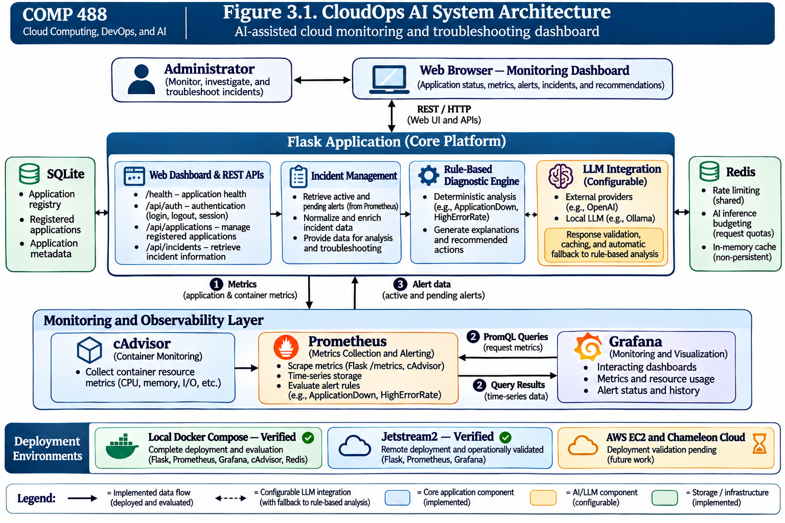
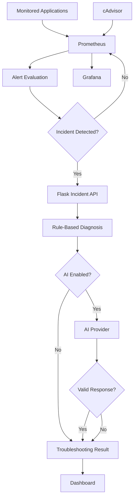

# CloudOps AI

**AI-Assisted Cloud Monitoring and Troubleshooting Platform**

An academic project investigating the integration of cloud application monitoring, incident detection, and hybrid AI-assisted troubleshooting.

**COMP 488 – Cloud Computing, DevOps, and AI**

Loyola University Chicago · November 2026

---

## Project Overview

Modern cloud applications require continuous monitoring to maintain availability and operational reliability. Although conventional monitoring platforms can detect predefined failure conditions, understanding incidents and identifying appropriate troubleshooting actions can still require manual investigation.

CloudOps AI explores an integrated approach combining conventional monitoring infrastructure, deterministic incident diagnosis, and optional large language model (LLM) assistance.

The platform combines Flask, Prometheus, Grafana, cAdvisor, SQLite, Redis, and Docker Compose.

## Research Objectives

1. Integrate application monitoring and AI-assisted troubleshooting.
2. Evaluate monitoring rules and incident detection.
3. Measure application failure detection and recovery latency.
4. Evaluate deterministic troubleshooting and AI fallback.
5. Benchmark HTTP performance under different workloads.
6. Validate deployment and operational integration.

## System Architecture

**Figure 1.** Overall architecture of the CloudOps AI platform.

### Incident Detection and Troubleshooting Workflow

