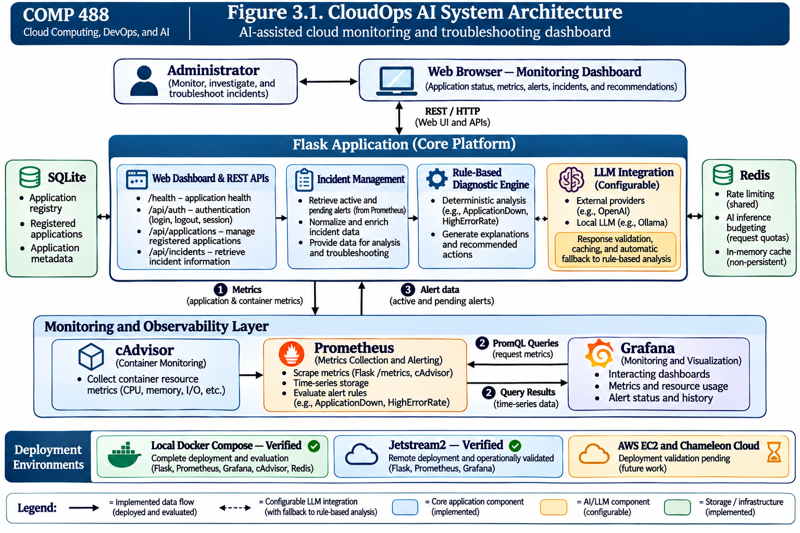

# AI-Assisted Cloud Monitoring and Troubleshooting Dashboard

**Academic Project Report**

**Student:** Khalidou Bass
**Course:** COMP 488 – Cloud Computing, DevOps, and AI
**Instructor:** Gregor von Laszewski
**Institution:** Loyola University Chicago
**Date:** November 2026

---

# Abstract

Cloud-based applications require continuous monitoring and effective incident management to maintain availability and operational reliability. Although conventional monitoring platforms provide mechanisms for collecting system metrics and detecting predefined failure conditions, interpreting incidents and identifying appropriate troubleshooting actions may still require substantial manual investigation. This project presents the design, implementation, and experimental evaluation of CloudOps AI, a containerized application monitoring and troubleshooting platform that integrates conventional monitoring technologies with rule-based and optional artificial intelligence (AI)-assisted incident analysis.

The platform combines a Python Flask backend with Prometheus for metrics collection and alert evaluation, Grafana for monitoring visualization, and cAdvisor for container resource monitoring. SQLite provides persistent application registration, while Redis supports shared request limiting and AI inference budgeting. Its hybrid troubleshooting architecture combines deterministic diagnostic rules with configurable large language model integrations to generate structured incident explanations and troubleshooting recommendations. Reliability mechanisms include structured response validation, configurable inference timeouts, diagnosis caching, inference budgeting, and automatic fallback to rule-based analysis.

The system was evaluated through automated functional testing, controlled application failure and recovery experiments, HTTP performance benchmarking, and remote deployment validation. The automated test suite completed with 156 passing tests and 10 passing subtests. Across three controlled application downtime trials, mean Prometheus alert detection and recovery latencies were approximately 24.66 seconds and 9.62 seconds, respectively. A separate controlled HTTP error-rate experiment generated 481 HTTP 500 responses over approximately 100.2 seconds, producing an observed error ratio of 93.68%. The HighErrorRate alert transitioned to the firing state and subsequently returned to its inactive state after normal operation was restored. HTTP performance benchmarking recorded 29,000 successful requests during an approximately 31-second sustained workload, achieving an overall measured throughput of 938.92 requests per second and a 95th-percentile response latency of 17.605 milliseconds. Additionally, the primary application and monitoring services were successfully deployed and operationally verified on the Jetstream2 research cloud.

The findings demonstrate the feasibility of integrating application monitoring, incident detection, and hybrid troubleshooting within a modular containerized platform. However, the evaluation is limited to the tested environments and workloads. Further investigation is required to evaluate live AI inference performance and diagnostic quality, as well as deployment behavior on additional cloud platforms, including AWS and Chameleon Cloud.

**Keywords:** Cloud Computing, Cloud Monitoring, DevOps, Prometheus, Grafana, Containerization, Incident Detection, Artificial Intelligence, Large Language Models, Automated Troubleshooting.

---

# 1. Introduction

## 1.1 Background and Motivation

The increasing adoption of cloud computing, distributed applications, and containerized infrastructure has introduced new challenges in maintaining application availability, reliability, and operational performance. Modern applications frequently depend on multiple interconnected services, making continuous monitoring and timely incident detection essential components of effective infrastructure management.

Monitoring and observability platforms such as Prometheus and Grafana provide mechanisms for collecting operational metrics, evaluating predefined conditions, and visualizing application and infrastructure health. These capabilities enable administrators to identify service disruptions, performance anomalies, and other operational issues. However, detecting an incident does not necessarily explain its underlying cause or provide sufficient guidance for resolving it. Administrators may therefore need to investigate monitoring data, application behavior, and service dependencies before determining an appropriate response.

Recent developments in artificial intelligence, particularly large language models (LLMs), offer opportunities to extend conventional monitoring systems with automated incident interpretation and troubleshooting assistance. By analyzing relevant operational information, AI-based components can generate explanations of detected incidents, identify potential causes, and suggest possible corrective actions.

Nevertheless, introducing AI into operational monitoring creates additional challenges, including inference latency, computational and financial costs, service availability, data privacy, and the reliability of generated recommendations. AI-generated explanations may also be incomplete or inaccurate, particularly when the available incident information is insufficient.

Consequently, AI-assisted troubleshooting should complement established monitoring mechanisms and deterministic diagnostic procedures rather than replace them.

Motivated by these considerations, this project investigates the design and implementation of an integrated application monitoring and troubleshooting platform that combines conventional monitoring technologies, rule-based incident analysis, and optional AI-assisted interpretation.

## 1.2 Problem Statement

Conventional application monitoring systems provide valuable capabilities for collecting metrics, detecting predefined operational conditions, and generating alerts. However, the identification of an operational incident does not necessarily provide administrators with an explanation of why the incident occurred or how it should be investigated.

This creates a gap between incident detection and incident interpretation. Although monitoring systems can identify conditions such as application unavailability and elevated HTTP error rates, administrators may still need to manually examine monitoring information, application behavior, and relevant operational context to identify possible causes and determine appropriate troubleshooting actions.

Furthermore, relying exclusively on external AI services for incident interpretation introduces additional dependencies. An unavailable AI provider, excessive inference requests, invalid model responses, or connectivity problems may prevent the delivery of troubleshooting assistance.

This project addresses these challenges through the development of an integrated monitoring and troubleshooting platform that combines application monitoring, rule-based incident diagnosis, and optional LLM-assisted analysis. The proposed approach retains deterministic troubleshooting capabilities as a fallback mechanism while providing an extensible architecture for AI-assisted incident interpretation.

## 1.3 Project Aim

The primary aim of this project is to design, implement, and experimentally evaluate a containerized cloud monitoring and troubleshooting platform that integrates conventional monitoring mechanisms with hybrid rule-based and AI-assisted incident analysis.

The platform is intended to provide administrators with a centralized interface for monitoring application health, visualizing operational metrics, identifying detected incidents, and obtaining explanations of potential problems and recommended troubleshooting actions.

The project also investigates the operational behavior of the platform through controlled performance experiments, alert detection and recovery measurements, automated functional testing, and deployment validation in local and remote cloud environments.

## 1.4 Research and Evaluation Questions

The project is guided by the following research and evaluation questions:

1. How can application monitoring, incident detection, and AI-assisted troubleshooting be integrated into a unified containerized platform?
2. How effectively can monitoring rules detect selected application failures and elevated HTTP error rates?
3. What detection and recovery latencies can be observed under controlled application failure and recovery conditions?
4. How can rule-based troubleshooting provide a reliable fallback when external AI services are unavailable, disabled, or return invalid responses?
5. What performance and operational characteristics can be observed under sequential, concurrent, and sustained HTTP workloads?
6. What deployment and operational considerations arise when implementing the monitoring platform in local and remote cloud environments?

These questions guide the system design, implementation, and experimental evaluation presented in this report.

## 1.5 Project Contributions

The principal contributions of this project are as follows:

- **Integrated monitoring platform:** Design and implementation of a containerized application monitoring platform combining Flask, Prometheus, Grafana, and cAdvisor.
- **Application management and monitoring integration:** Development of application registration, authentication, monitoring discovery, and incident management capabilities through backend REST APIs.
- **Hybrid troubleshooting architecture:** Implementation of deterministic rule-based incident analysis alongside configurable LLM-assisted explanations and troubleshooting recommendations.
- **AI integration safeguards:** Development of structured AI responses, configurable inference timeouts, caching, request budgeting, and automatic fallback to rule-based analysis.
- **Automated testing and deployment support:** Development of automated tests, deployment validation scripts, health checks, and Docker Compose configurations.
- **Experimental evaluation:** Measurement of application response latency and throughput, Prometheus alert detection and recovery latency, and application behavior under controlled workloads.
- **Remote deployment demonstration:** Deployment and operational verification of the primary application and monitoring services on the Jetstream2 research cloud.

The project focuses on developing and evaluating a functional prototype that demonstrates the integration of cloud monitoring, DevOps practices, and AI-assisted troubleshooting. It does not attempt to establish production-scale performance or demonstrate fully autonomous incident remediation.

# 2. Background and Related Work

## 2.1 Cloud Computing, DevOps, and Observability

Cloud computing enables organizations to provision and manage computing resources, storage, networking, and application services through flexible infrastructure environments. Modern cloud applications increasingly adopt distributed architectures and containerized services, allowing individual components to be deployed, scaled, and managed independently.

However, distributed environments introduce operational complexity. A failure in one service may affect dependent components, while performance degradation can arise from resource constraints, network communication problems, configuration errors, or application-level defects.

DevOps practices address these challenges by integrating software development and IT operations through automation, continuous integration, continuous delivery, infrastructure management, and continuous monitoring. Monitoring and observability are important components of these practices because they provide operational information that helps administrators understand application behavior and investigate failures.

Observability refers to the ability to understand the internal state of a system through information emitted by that system. OpenTelemetry identifies several categories of telemetry signals, including metrics, logs, and traces [1].

These signals provide complementary forms of operational information:

- **Metrics:** Numerical measurements describing system and application behavior over time, such as request rates, response latency, error rates, and resource utilization.
- **Logs:** Timestamped records of application events, errors, and operational activities.
- **Traces:** Records of request execution across application components and distributed services.

Metrics are particularly useful for identifying changes in system behavior, while logs and traces can provide additional context during incident investigation.

The CloudOps AI platform primarily focuses on metrics-based monitoring and incident detection. Prometheus collects application metrics, while Grafana provides visualization. cAdvisor supplies container resource measurements in the local deployment.

Comprehensive centralized log aggregation and distributed tracing are outside the current implementation scope. Consequently, the platform should be understood as a metrics-oriented monitoring and troubleshooting prototype rather than a complete observability solution.

## 2.2 Application and Infrastructure Monitoring

Application monitoring involves observing the availability, performance, and operational behavior of software services. Common monitoring indicators include service availability, HTTP response status codes, request throughput, response latency, and resource utilization.

Infrastructure monitoring complements application monitoring by examining the underlying resources on which applications execute. These resources include CPU, memory, storage, and container-level operational characteristics.

Containerized applications introduce additional monitoring requirements because individual services execute within isolated environments managed by container runtimes. Monitoring only application-level health may therefore provide an incomplete picture of operational conditions. Container-level resource measurements can help identify resource constraints and distinguish application failures from infrastructure-related problems.

In this project, monitoring is implemented through several complementary components:

- Flask exposes application health information and Prometheus-compatible metrics.
- Prometheus collects metrics and evaluates predefined alerting conditions.
- cAdvisor provides container resource measurements in the local deployment.
- Grafana visualizes monitoring information and operational metrics.

This arrangement provides application-level and container-level monitoring within a unified deployment environment.

## 2.3 Metrics Collection and Alert Management

### 2.3.1 Prometheus

Prometheus is an open-source monitoring system and time-series database designed to collect and query numerical measurements from monitored targets.

Its monitoring model commonly uses periodic scraping, whereby the Prometheus server retrieves metrics from configured HTTP endpoints. Each collected measurement is stored as a time series identified by its metric name and associated labels.

Prometheus provides PromQL, a query language for selecting, aggregating, and analyzing time-series data. It also supports recording and alerting rules that evaluate collected measurements and identify operational conditions requiring attention [2].

An important feature of Prometheus alerting is the configurable pending period. An alert condition may need to remain continuously true for a specified duration before the alert transitions into the firing state. This mechanism helps prevent transient conditions from immediately generating alerts.

The CloudOps AI implementation uses Prometheus to collect metrics from the Flask application and evaluate operational conditions. Two principal application-level alert scenarios are considered:

1. **ApplicationDown:** Detects application unavailability through the Prometheus target health metric.
2. **HighErrorRate:** Identifies an elevated proportion of HTTP server errors over a configured observation window.

The ApplicationDown rule used in the controlled latency experiment is based on the following PromQL expression:

`up{job="flask-app"} == 0`

The alert is configured with a 15-second pending duration, while the Prometheus scrape and evaluation intervals are both configured to five seconds.

These settings provide the basis for the controlled failure-detection and recovery experiments described in Chapter 5.

### 2.3.2 Grafana

Grafana is an open-source visualization and observability platform that supports monitoring data from multiple sources. It provides dashboards, panels, queries, and visualization mechanisms for presenting operational information.

Grafana integrates with Prometheus as a data source, allowing administrators to query and visualize collected time-series metrics using PromQL [3].

In CloudOps AI, Grafana serves as the monitoring visualization layer. It provides a centralized interface for examining application and infrastructure metrics.

Prometheus and Grafana perform complementary functions: Prometheus is responsible for metrics collection and time-series storage, whereas Grafana provides the visualization interface.

### 2.3.3 Container Resource Monitoring

Container resource monitoring provides visibility into the operational characteristics of containerized workloads.

cAdvisor, or Container Advisor, analyzes and exposes resource usage and performance information from running containers. Its metrics can be collected by Prometheus for subsequent querying and visualization [4].

In the local CloudOps AI deployment, cAdvisor complements application-level monitoring by providing container resource measurements.

This integration supports a broader monitoring perspective than application health checks alone. Nevertheless, resource monitoring does not automatically establish the root cause of an incident; additional diagnostic interpretation may still be required.

### 2.3.4 Containerization and Service Orchestration

Containerization packages applications and their dependencies into isolated execution environments. This approach supports consistency between development and deployment environments and simplifies application distribution.

Docker Compose provides a mechanism for defining and managing multi-container applications through a declarative YAML configuration. It allows services, networks, volumes, and configuration parameters to be managed as part of a single application environment [5].

CloudOps AI uses Docker Compose to orchestrate its application and monitoring services. This includes Flask, Prometheus, Grafana, cAdvisor, and Redis.

The use of Compose simplifies local development, testing, service startup, and deployment configuration. It also provides a common configuration model for evaluating the application in different environments, although successful configuration validation alone does not establish deployment compatibility across all cloud providers.

## 2.4 Rule-Based Incident Diagnosis

Rule-based diagnosis uses predefined conditions and diagnostic logic to associate observed operational events with possible explanations and recommended actions.

In conventional monitoring environments, alert rules identify conditions such as application unavailability, elevated error rates, or resource threshold violations. Additional diagnostic rules can interpret these conditions and provide administrators with structured troubleshooting guidance.

Rule-based approaches have several advantages:

- **Deterministic behavior:** Given the same inputs and configuration, the diagnostic logic produces predictable results.
- **Low inference overhead:** Diagnosis does not require an external AI service.
- **Operational independence:** Rule-based analysis can continue functioning when an external model provider is unavailable.
- **Transparency:** Diagnostic conditions and associated recommendations can be explicitly inspected.

However, predefined rules are limited by their coverage and the operational scenarios anticipated during development. Complex incidents involving multiple interacting components may not be adequately represented by a fixed set of rules.

Within CloudOps AI, rule-based troubleshooting provides the foundational incident-analysis mechanism. It supports selected incident categories and produces explanations, possible causes, and recommended actions.

The rule-based component also serves as a fallback mechanism for the optional AI-assisted troubleshooting layer.

## 2.5 Artificial Intelligence and AIOps

Artificial Intelligence for IT Operations (AIOps) refers to the application of artificial intelligence and data-driven techniques to operational activities such as anomaly detection, incident analysis, failure prediction, root-cause identification, and remediation support.

Traditional AIOps approaches have investigated techniques including statistical analysis, machine learning, clustering, and automated pattern recognition to identify abnormal operational behavior and support incident management [6].

More recently, large language models have attracted research interest because of their ability to interpret natural-language information, summarize operational events, and generate contextual explanations.

Zhang et al. [7] provide a survey of AIOps research in the era of large language models. Their study analyzes 183 research articles published between January 2020 and December 2024, examining how LLMs can contribute to different stages of IT operations workflows.

The survey illustrates the expanding research interest in applying LLMs to operational tasks while identifying challenges and opportunities for further investigation.

### 2.5.1 LLM-Assisted Incident Analysis

Large language models can process structured and unstructured information and generate natural-language explanations based on supplied context.

In incident management, this capability can be used to interpret alert descriptions, summarize operational events, identify potential causes, and recommend troubleshooting procedures.

Zhang et al. [8] investigate the use of in-context learning with GPT-4 for automated root-cause analysis of cloud incidents. Their study evaluates different language models using a dataset containing more than 100,000 production incidents. The authors investigate whether providing relevant incident context can improve root-cause identification without requiring model fine-tuning.

Similarly, Chen et al. [9] introduce RCACopilot, an LLM-assisted incident diagnosis system presented at EuroSys 2024. The system associates incoming incidents with relevant diagnostic handlers, collects runtime diagnostic information, predicts root-cause categories, and generates explanatory narratives.

Their evaluation uses a real-world dataset of Microsoft cloud incidents and reports root-cause analysis accuracy of up to 0.766.

These studies demonstrate the research potential of LLMs in incident management. However, their evaluations use substantial production incident datasets and experimental settings that differ from the smaller prototype developed in this project.

CloudOps AI adopts a more limited integration model. Rather than attempting to reproduce the capabilities or evaluation scale of these research systems, it uses LLMs as optional troubleshooting assistants that receive selected incident information and generate structured diagnostic responses.

### 2.5.2 Limitations and Operational Considerations

Despite their potential, LLM-based troubleshooting systems introduce several operational considerations.

**Inference latency:** Generating model responses introduces additional processing time compared with deterministic diagnostic rules.

**Availability and dependency management:** Hosted AI services depend on network connectivity, provider availability, authentication, and external service configuration.

**Response reliability:** Generated recommendations may be incomplete, inaccurate, or inconsistent with the actual operational condition. Research examining LLM-generated root-cause explanations and mitigation recommendations demonstrates the importance of evaluating the quality and practical relevance of these outputs before relying on them operationally [10].

**Resource and financial costs:** Model inference may require substantial computational resources or incur usage-based service charges.

**Data privacy:** Incident descriptions and operational information may contain sensitive details that should not be unnecessarily transmitted to external providers.

**Security:** Untrusted incident information may contain instructions intended to manipulate model behavior, creating prompt-injection risks.

These considerations motivate the use of controlled AI integration, response validation, request limits, and deterministic fallback mechanisms.

## 2.6 Hybrid AI-Assisted Troubleshooting

A hybrid troubleshooting architecture combines deterministic diagnostic mechanisms with AI-generated interpretation.

The approach is motivated by the complementary characteristics of rule-based systems and LLMs. Rule-based mechanisms provide predictable behavior for known operational conditions, while language models can generate contextual explanations and recommendations based on supplied incident information.

A hybrid architecture can therefore retain a deterministic diagnostic baseline while providing optional AI assistance.

In CloudOps AI, the hybrid troubleshooting component follows this general process:

1. Receive incident information from the monitoring and incident-management components.
2. Evaluate the incident using predefined diagnostic rules.
3. Determine whether AI-assisted analysis is enabled and available.
4. Apply inference-budget controls before submitting an AI request.
5. Send selected incident information to the configured provider.
6. Validate and process the returned structured response.
7. Use rule-based troubleshooting when AI assistance is disabled, unavailable, or produces an invalid response.
8. Return the resulting explanation and recommendations through the backend API.

The implementation includes configurable AI provider integrations, request timeouts, response validation, caching, and inference-budget controls. It also supports automatic fallback to rule-based analysis.

An important design consideration is that AI-generated recommendations are informational. The current implementation does not automatically execute corrective actions. This preserves administrator oversight and reduces the operational risks associated with autonomous remediation.

The architecture therefore emphasizes AI-assisted interpretation rather than autonomous infrastructure management.

## 2.7 Research Motivation and Positioning

Recent research has explored the application of large language models to cloud incident management, particularly automated root-cause analysis and mitigation recommendation. Studies such as the in-context learning approach presented by Zhang et al. [8] and the RCACopilot system developed by Chen et al. [9] demonstrate different approaches to applying LLMs to operational incident diagnosis.

However, the development of an operational monitoring platform also involves practical engineering requirements beyond model-generated explanations. These include application registration, monitoring discovery, metrics collection, alert evaluation, authentication, deployment management, service reliability, and controlled integration with external AI providers.

This project addresses these engineering considerations through the implementation of an integrated containerized monitoring and troubleshooting prototype.

Its contribution lies in combining conventional monitoring infrastructure with deterministic incident analysis and optional LLM-assisted troubleshooting within a modular application architecture.

Unlike large-scale research systems evaluated using extensive production incident datasets, CloudOps AI is developed and evaluated as a practical prototype using controlled application experiments, automated testing, HTTP performance benchmarking, and remote deployment validation.

The evaluation therefore focuses on demonstrating functional integration, operational behavior, and the feasibility of the proposed hybrid architecture. Establishing the diagnostic accuracy and operational benefits of live AI inference remains an important area for future experimental work.

---

# 3. System Requirements and Architecture

## 3.1 System Requirements

The system requirements were established based on the project's primary objective of integrating application monitoring, incident detection, and AI-assisted troubleshooting within a containerized environment.

The requirements are divided into functional and non-functional requirements.

### 3.1.1 Functional Requirements

The principal functional requirements are:

| ID | Requirement | Description |
|---|---|---|
| FR-01 | Application health monitoring | The system shall expose application health information through an HTTP endpoint. |
| FR-02 | Metrics collection | The system shall expose application metrics for collection by Prometheus. |
| FR-03 | Application registration | Administrators shall be able to register applications with their monitoring endpoints. |
| FR-04 | Monitoring visualization | The system shall provide monitoring dashboards through Grafana. |
| FR-05 | Incident detection | The system shall identify configured operational conditions, including application downtime and elevated HTTP error rates. |
| FR-06 | Incident management | The backend shall provide API access to incident information. |
| FR-07 | Rule-based troubleshooting | The system shall provide deterministic explanations and recommendations for supported incident categories. |
| FR-08 | AI-assisted troubleshooting | The system shall support optional LLM-based incident interpretation through configurable providers. |
| FR-09 | AI fallback | The system shall retain rule-based troubleshooting when AI assistance is disabled, unavailable, or returns an invalid response. |
| FR-10 | Administrative authentication | The system shall protect administrative functionality through authentication mechanisms. |
| FR-11 | Request and inference controls | The system shall apply request-limiting and AI inference-budget controls. |
| FR-12 | Deployment support | The system shall support containerized deployment through Docker Compose. |

These requirements describe the implemented core platform. The proposed Flutter mobile application and automated remediation capabilities are not included as completed functional requirements.

### 3.1.2 Non-Functional Requirements

The system also considers the following non-functional requirements:

**Reliability:** The monitoring and troubleshooting components should operate independently where possible. In particular, rule-based analysis should remain available when external AI services cannot be accessed.

**Security:** Administrative functionality should require authentication. External AI requests should be controlled, and incident information should be handled as untrusted input.

**Maintainability:** The system should use modular components that allow monitoring, troubleshooting, and infrastructure functionality to be maintained independently.

**Portability:** Containerization and declarative service configuration should support deployment across compatible development and cloud environments.

**Performance:** The application should provide responsive health and API endpoints under the evaluated workloads.

**Resource efficiency:** AI inference requests should be controlled through configurable budgets and caching mechanisms to reduce unnecessary external requests.

**Extensibility:** The architecture should allow additional monitoring targets and AI providers to be incorporated without requiring a complete redesign.

These requirements informed the implementation and evaluation activities described in the subsequent chapters.

## 3.2 Overall System Architecture

CloudOps AI follows a modular, service-oriented architecture in which the Flask application provides the central application and backend functionality, while supporting services perform monitoring, visualization, container resource collection, and request-limiting operations.

The architecture separates application functionality from monitoring infrastructure and AI-assisted troubleshooting. This separation allows the monitoring system to continue collecting operational information independently of the availability of external AI providers.

The principal architectural components are:

1. Application and presentation layer.
2. Backend API and application management layer.
3. Monitoring and alerting layer.
4. Visualization layer.
5. Supporting infrastructure and data storage.
6. Hybrid troubleshooting layer.
7. Deployment infrastructure.

### 3.2.1 Target System Architecture

The overall architecture is illustrated in Figure 3.1.

**Figure 3.1.** Overall architecture of the CloudOps AI monitoring and troubleshooting platform.

The architecture illustrates the relationships between the application, monitoring infrastructure, supporting services, and troubleshooting functionality.

The primary operational workflow is:

**Application Monitoring → Metrics Collection → Incident Detection → Rule-Based Analysis → Optional AI-Assisted Interpretation → Troubleshooting Recommendations**

The monitoring system provides the operational information required for incident detection. The troubleshooting component then interprets supported incidents and produces explanations and recommendations.

AI assistance is optional. The platform retains deterministic diagnostic functionality when AI services are unavailable or disabled.

## 3.3 Application and Backend Architecture

The application and backend are implemented using Python and Flask.

Flask provides the web application, administrative interface, health endpoints, monitoring metrics, and REST API functionality.

The backend exposes several categories of endpoints:

- **Application health:** Provides information about application availability.
- **Metrics:** Exposes Prometheus-compatible application measurements through the `/metrics` endpoint.
- **Application management:** Supports retrieving and registering monitored applications through `/api/applications`.
- **Authentication:** Provides administrative login, logout, and session-validation functionality.
- **Incident management:** Exposes incident information through `/api/incidents`.
- **Troubleshooting:** Provides access to diagnostic explanations and recommendations.

The backend acts as the central integration point between the monitoring infrastructure, application registry, authentication mechanisms, and troubleshooting components.

Administrative operations are protected by authentication and associated request-security controls.

The REST API architecture also provides a potential integration point for additional client applications. However, the proposed Flutter mobile application has not been implemented as part of the evaluated system.

## 3.4 Monitoring and Incident Detection Architecture

The monitoring architecture combines Prometheus, Grafana, and cAdvisor to provide application-level and container-level operational visibility.

### 3.4.1 Application Metrics Collection

The Flask application exposes metrics through an HTTP endpoint.

Prometheus periodically retrieves these measurements using a pull-based scraping mechanism. The collected time-series data can then be queried and used by configured alerting rules.

In the local deployment, the Flask service is exposed internally through the Docker Compose service name `app` on port 8000.

The Prometheus configuration uses the `flask-app` job to collect metrics from:

`http://app:8000/metrics`

The local configuration uses a five-second scrape interval.

This integration provides the monitoring data required for application health assessment and alert evaluation.

### 3.4.2 Alert Evaluation

Prometheus evaluates predefined alerting rules against the collected metrics.

Two principal operational conditions were implemented and tested:

- **ApplicationDown:** Identifies application unavailability using the Prometheus target health metric.
- **HighErrorRate:** Identifies an elevated proportion of HTTP server errors over a configured observation window.

The ApplicationDown rule uses the expression:

`up{job="flask-app"} == 0`

The configured alert duration is 15 seconds, while the scrape and evaluation intervals are both five seconds.

The HighErrorRate rule evaluates the proportion of HTTP 5xx responses over a one-minute rate window and requires the condition to remain satisfied for 30 seconds.

The alerting architecture therefore separates metric collection from incident interpretation. Prometheus identifies operational conditions, while the backend troubleshooting component provides additional diagnostic information.

### 3.4.3 Container Resource Monitoring

cAdvisor provides container-level resource measurements in the local deployment.

These measurements complement application metrics by providing information about container resource utilization and operational behavior.

Prometheus collects the available cAdvisor metrics, allowing them to be queried and visualized through Grafana.

The integration provides additional operational visibility but does not automatically identify the root cause of every resource-related incident.

### 3.4.4 Monitoring Visualization

Grafana provides the visualization layer of the platform.

It uses Prometheus as a monitoring data source and presents operational information through dashboards and panels.

This separation allows Prometheus to focus on metrics collection and alert evaluation while Grafana provides the interface for examining monitoring information.

## 3.5 Hybrid AI-Assisted Troubleshooting Architecture

The troubleshooting architecture combines deterministic diagnostic rules with optional large language model integrations.

Its purpose is to extend conventional incident detection with explanations of potential causes and recommendations for investigating detected operational problems.

### 3.5.1 Rule-Based Analysis

The rule-based component provides deterministic diagnostic behavior for supported incident categories.

It evaluates available incident information and produces structured troubleshooting information, including explanations, possible causes, and recommended actions.

This component does not depend on external AI services and therefore provides a baseline diagnostic capability when AI assistance is unavailable.

### 3.5.2 LLM Provider Integration

The platform implements a provider abstraction that supports different language-model inference environments.

Two provider implementations are available:

- **OpenAI-compatible provider:** Supports OpenAI hosted inference and compatible endpoints, including DashScope and the Jetstream inference endpoint.
- **Ollama provider:** Supports locally hosted language models through the Ollama API.

Provider selection is controlled through the `CLOUDOPS_AI_PROVIDER` environment variable. A shared provider interface allows different inference implementations to be selected without changing the core troubleshooting logic.

The OpenAI-compatible provider uses configurable endpoint and model settings and requires an API key. Its request timeout is configurable through `CLOUDOPS_AI_TIMEOUT_SECONDS`, with permitted values between 1 and 120 seconds. The Ollama implementation uses a locally configured endpoint and a fixed request timeout of 120 seconds.

Both implementations submit selected incident information and request structured diagnostic output containing an explanation, possible causes, and recommended actions. The system instructs the model to treat incident information as untrusted input and provide read-only guidance without claiming that a root cause has been confirmed.

AI-assisted analysis is disabled by default and requires explicit configuration. Provider integrations are covered by automated tests using mocked responses to validate request construction, configuration, timeout handling, and response processing. These tests do not establish successful live inference or diagnostic accuracy.

### 3.5.3 Hybrid Analysis and Fallback

The hybrid troubleshooting mechanism combines deterministic rule-based diagnosis with optional AI-assisted analysis.

The processing sequence is as follows:

1. Receive the incident information and generate a deterministic rule-based diagnosis.
2. Return the rule-based result if AI assistance is unavailable or disabled.
3. Check the diagnosis cache for a previously generated result.
4. Acquire an inference lock and check the cache again to avoid unnecessary duplicate inference requests.
5. Check the configured inference budget before initiating an AI request.
6. Submit the selected incident information to the configured AI provider when inference is permitted.
7. Validate the returned explanation, possible causes, and recommended actions.
8. Cache a valid AI-assisted diagnosis and return it through the backend interface.
9. Return the original rule-based diagnosis if inference is unavailable, the budget is exhausted, the response is invalid, or an inference error occurs.

Structured response validation ensures that AI-generated information conforms to the expected output format. Deterministic troubleshooting remains an independent fallback, reducing the platform's dependence on external inference services.

AI-generated recommendations are informational and do not directly execute infrastructure operations. The current implementation retains administrator oversight and does not provide autonomous incident remediation.

## 3.6 Data Storage and Supporting Infrastructure

The platform uses SQLite and Redis for different operational requirements.

### 3.6.1 SQLite Application Registry

SQLite provides persistent storage for registered applications.

The default database location is:

`data/applications.db`

The location can be changed through the `CLOUDOPS_DB_PATH` environment variable.

The application registry stores:

- Application identifier.
- Application name.
- Deployment environment.
- Health-check URL.
- Optional metrics URL.
- Enabled status.
- Monitoring approval status.
- Registration timestamp.

The database is accessed through Python's SQLite interface.

Docker Compose mounts the host directory `./data` at `/app/data` inside the application container. This allows the application registry database to persist outside the container's writable filesystem.

### 3.6.2 Redis Supporting Infrastructure

Redis provides shared storage for request-limiting operations and AI inference budgeting.

The implementation includes a Redis-backed sliding-window inference budget that coordinates request limits across application instances.

The configuration uses the following environment variables:

- `CLOUDOPS_RATE_LIMIT_STORAGE_URI`
- `CLOUDOPS_AI_BUDGET_REDIS_URL`

The Redis service is configured without persistence in the current Docker Compose deployment. Consequently, its in-memory state is not retained when the service is recreated.

SQLite and Redis therefore serve distinct purposes: SQLite maintains the persistent application registry, whereas Redis supports shared operational controls.

### 3.6.3 Monitoring Data Storage

Prometheus collects and stores time-series monitoring measurements, while Grafana provides their visualization.

The current Docker Compose configuration mounts Prometheus configuration files and Grafana provisioning and dashboard files.

However, it does not define dedicated persistent data volumes for Prometheus or Grafana application data. Consequently, persistence of monitoring history and Grafana runtime state is not guaranteed across container recreation.

This limitation is considered when discussing the reliability and deployment characteristics of the platform.

## 3.7 Deployment Architecture

The system supports two principal deployment contexts: local development and remote cloud deployment.

### 3.7.1 Local Docker Compose Deployment

The local environment is the primary development and experimental environment.

It includes:

| Service | Main responsibility | Container port |
|---|---|---:|
| Flask application | Dashboard, backend APIs, application metrics | 8000 |
| Prometheus | Metrics collection and alert evaluation | 9090 |
| Grafana | Monitoring visualization | 3000 |
| cAdvisor | Container resource monitoring | 8080 |
| Redis | Shared request-limiting and inference-budget storage | 6379 |

The application, Prometheus, and Grafana interfaces are bound to localhost in the development configuration.

Docker Compose defines service dependencies, health checks, restart policies, and volume mounts to support consistent local deployment.

This environment is used for automated functional testing, controlled incident simulation, and HTTP performance benchmarking.

### 3.7.2 Remote Jetstream2 Deployment

The remote deployment was conducted on an Ubuntu virtual machine hosted on the Jetstream2 research cloud [11].

Docker Compose was used to deploy the Flask application, Prometheus, and Grafana.

The deployment was verified through service health checks and Prometheus target discovery.

Prometheus successfully discovered the Flask metrics endpoint at `app:8000` and reported the `flask-app` target as healthy.

Grafana's health endpoint also confirmed that its database was operational.

The remote experiment was limited to the primary application and monitoring services. It did not constitute a complete deployment of every local supporting component or a performance comparison between cloud providers.

The virtual machine was deleted after the verification activities to avoid unnecessary consumption of shared cloud computing resources.

### 3.7.3 Deployment Boundaries

The current implementation has been validated locally and through a limited Jetstream2 deployment.

Deployment validation on AWS EC2 and Chameleon Cloud remains outstanding.

Similarly, the current architecture does not include a production-grade multi-node monitoring configuration, comprehensive distributed tracing, or automated incident remediation.

These boundaries distinguish the implemented prototype from a production-scale cloud operations platform.

## 3.8 Architectural Design Considerations

Several architectural decisions were made to balance functionality, maintainability, and operational reliability.

First, the monitoring infrastructure is separated from the troubleshooting component. This allows metrics collection and alert evaluation to operate independently of external AI inference.

Second, deterministic troubleshooting is retained as a fallback mechanism. This reduces dependence on external AI providers and ensures that selected incident categories remain diagnosable when AI assistance is unavailable.

Third, application registration and operational controls use separate storage technologies. SQLite maintains the application registry, while Redis provides shared, in-memory infrastructure for request limiting and inference budgeting.

Fourth, Docker Compose provides a consistent method for defining the local application and its supporting services. The same general containerization approach also supports the demonstrated remote deployment.

Finally, AI-generated recommendations are separated from infrastructure execution. This preserves administrator oversight and avoids introducing autonomous remediation risks into the current prototype.

These design decisions establish the architectural foundation for the implementation and experimental evaluation presented in the following chapters.

# 4. System Implementation

## 4.1 Implementation Overview

The CloudOps AI prototype was implemented as a modular, containerized application combining a Flask backend, a JavaScript-based web dashboard, Prometheus monitoring, Grafana visualization, and a hybrid AI-assisted troubleshooting component.

The implementation follows a separation-of-concerns approach. Application management, monitoring, incident analysis, authentication, and supporting infrastructure are organized into distinct components. This structure allows monitoring and deterministic troubleshooting to remain operational independently of external AI services.

The principal implementation components are:

- **Application backend:** Provides HTTP endpoints, application registration, authentication, incident retrieval, and metrics exposure.
- **Web dashboard:** Presents application status, registered applications, monitoring incidents, and troubleshooting recommendations.
- **Monitoring infrastructure:** Uses Prometheus to collect metrics and evaluate alerting rules.
- **Visualization infrastructure:** Uses Grafana to display application and container metrics.
- **Container monitoring:** Uses cAdvisor to collect container resource measurements.
- **AI troubleshooting:** Combines deterministic diagnostic rules with optional external or local language models.
- **Supporting infrastructure:** Uses SQLite for application registration and Redis for shared rate limiting and AI inference budgeting.

## 4.2 Development Environment and Technology Stack

The system was developed using Python and JavaScript, with Docker Compose providing the local deployment environment.

The principal technologies include:

| Component | Technology | Responsibility |
|---|---|---|
| Backend | Python 3.14, Flask 3.1 | Application APIs and business logic |
| Frontend | HTML5, CSS3, JavaScript | Dashboard interface and interactions |
| Application server | Gunicorn | Production-oriented WSGI serving |
| Database | SQLite | Persistent application registry |
| Supporting storage | Redis 7.4 | Shared rate limiting and inference budgeting |
| Metrics collection | Prometheus 3.15 | Metrics scraping and alert evaluation |
| Visualization | Grafana 13.2 | Monitoring dashboards |
| Container monitoring | cAdvisor 0.55 | Container resource metrics |
| Containerization | Docker and Docker Compose | Service packaging and orchestration |
| AI integration | OpenAI-compatible API and Ollama | Optional incident analysis |

The application uses a Python package structure, with its implementation located in `src/kbass_monitoring/`. Automated tests are maintained separately in the `tests/` directory.

The project also uses a dependency lock file to support more reproducible container builds.

## 4.3 Backend Implementation

The backend is implemented using Flask and exposes HTTP endpoints for application health, monitoring incidents, application registration, administrator authentication, monitoring discovery, and Prometheus metrics.

The main application entry point is `src/kbass_monitoring/app.py`.

### 4.3.1 Application Health and Metrics

The `/health` endpoint provides a lightweight health response indicating whether the Flask application is operational.

The `/metrics` endpoint exposes application metrics in Prometheus exposition format.

An HTTP request counter, `app_http_requests_total`, records requests using the following labels:

- HTTP method
- Request endpoint
- HTTP response status

The application uses the Prometheus Python client to expose these measurements.

For multi-worker deployment, Gunicorn is configured with two workers, and Prometheus multiprocess mode aggregates metrics across worker processes.

The application entry point is executed through a shell script that initializes the multiprocess metrics directory before starting Gunicorn.

### 4.3.2 Incident Retrieval API

The `/api/incidents` endpoint retrieves active and pending alerts from the Prometheus HTTP API.

The backend normalizes the returned alert information into a consistent incident representation containing:

- Alert name
- Severity
- Current state
- Summary and description
- Activation timestamp
- Alert value and labels
- Troubleshooting analysis

If Prometheus is unavailable or returns invalid data, the endpoint returns HTTP 503 with an appropriate error response.

This behavior prevents monitoring failures from being incorrectly represented as an empty incident list.

### 4.3.3 Application Management API

The application management interface provides endpoints for registering and retrieving monitored applications.

The principal operations are:

| Method | Endpoint | Purpose |
|---|---|---|
| GET | `/api/applications` | Retrieve registered applications |
| POST | `/api/applications` | Register a new application |
| PATCH | `/api/applications/<id>/monitoring-approval` | Approve or revoke monitoring |
| GET | `/api/discovery/preview` | Preview eligible Prometheus targets |

Application registration accepts a name, deployment environment, health endpoint, and optional metrics endpoint.

The backend validates submitted information before storing it in the application registry.

The application listing endpoint intentionally excludes endpoint URLs from its response, limiting unnecessary exposure of registered application configuration.

Monitoring approval is maintained separately from application registration. Registering an application therefore does not automatically activate Prometheus scraping.

## 4.4 Web Dashboard Implementation

The web interface is implemented using HTML, CSS, and JavaScript without requiring a separate frontend framework.

The dashboard provides a centralized interface for viewing monitoring information and interacting with the backend.

### 4.4.1 Dashboard Layout and Design

The interface uses a dark-themed layout consisting of a navigation sidebar, a main content area, monitoring cards, data tables, and administrative controls.

CSS Grid and Flexbox are used to organize the interface. Responsive media queries adapt the layout to smaller screens.

The interface includes sections for:

- Monitoring overview
- Application management
- Incident monitoring
- AI-assisted troubleshooting
- Performance analytics

The design uses distinct status indicators for healthy services, warnings, and critical conditions.

### 4.4.2 Dynamic Data Retrieval

The JavaScript dashboard communicates with the Flask backend using asynchronous HTTP requests.

Three principal data sources are retrieved:

1. Application health through `/health`.
2. Monitoring incidents through `/api/incidents`.
3. Registered applications through `/api/applications`.

These requests are executed concurrently using `Promise.all()`.

The dashboard refreshes automatically every 15 seconds. Administrators can also trigger an immediate refresh through the refresh control.

A refresh-in-progress guard prevents overlapping dashboard refresh operations.

The interface displays the latest update time and provides explicit unavailable states when an API request fails.

### 4.4.3 Incident Visualization

Monitoring incidents are dynamically rendered in a table containing their names, severity levels, states, summaries, and detection timestamps.

Critical incidents are counted separately from other active incidents.

Administrators can select an incident through the *View Diagnosis* control to display its troubleshooting information.

The troubleshooting panel presents:

- Incident explanation
- Possible causes
- Recommended actions
- Diagnosis source
- Root-cause confirmation status

The interface distinguishes between AI-assisted and rule-based diagnoses.

Incident information is inserted into the document using safe DOM operations and `textContent`, rather than interpreting externally supplied incident descriptions as HTML.

### 4.4.4 Application Visualization

The application management section retrieves registered applications from the backend and displays their names, deployment environments, and enabled status.

The interface also provides an application registration form for administrators.

After successful registration, the form is reset, a confirmation message displays the generated application identifier, and the application listing is refreshed.

## 4.5 Administrator Authentication and Application Registration

Administrative operations are protected through token-based authentication and browser sessions.

### 4.5.1 Browser Authentication

The administrator initially authenticates using the configured management token.

The `/api/auth/login` endpoint validates the supplied token and establishes a browser session.

The Flask session is configured with:

- HTTP-only cookies
- SameSite protection
- A configurable secure-cookie setting
- A 30-minute permanent session lifetime

After successful authentication, the backend generates a CSRF token associated with the browser session.

The frontend retains this token in memory and supplies it through the `X-CSRF-Token` header for protected browser management operations.

### 4.5.2 Session Management

The implementation supports the following authentication operations:

| Endpoint | Method | Purpose |
|---|---|---|
| `/api/auth/login` | POST | Authenticate an administrator |
| `/api/auth/logout` | POST | Terminate an administrator session |
| `/api/auth/session` | GET | Validate and restore a browser session |

When the dashboard loads, it attempts to restore an existing authenticated session.

The frontend also periodically validates the session every 60 seconds. If validation fails, administrative controls are disabled and the administrator must authenticate again.

### 4.5.3 Application Registration Validation

Application registration requires an authenticated administrator.

The backend validates application names, deployment environments, and endpoint URLs before inserting records into SQLite.

The supported deployment environments are:

- Local
- Chameleon
- AWS
- Other

Endpoint validation restricts protocols to HTTP and HTTPS, rejects embedded credentials, prohibits non-standard ports, and rejects localhost, internal hostnames, and non-public IP addresses.

Additional DNS validation is available for approved monitoring targets before activation.

## 4.6 Monitoring and Alert Detection Implementation

Prometheus is responsible for collecting application and infrastructure metrics and evaluating monitoring rules.

The monitoring configuration uses a five-second scrape interval and a five-second evaluation interval.

### 4.6.1 Application Monitoring

The Flask application is monitored through the `flask-app` Prometheus job, which scrapes the application metrics endpoint.

The system also supports file-based service discovery for eligible registered applications.

The registered application discovery workflow separates target preview, administrator approval, and target-file generation.

This provides an additional control before external applications become monitoring targets.

### 4.6.2 Container Resource Monitoring

cAdvisor collects container-level resource measurements.

The collected metrics support monitoring of CPU utilization and memory working-set consumption.

Prometheus evaluates these measurements against configured thresholds.

### 4.6.3 Alerting Rules

Four principal alert rules are implemented:

| Alert | Condition | Evaluation duration |
|---|---|---|
| ApplicationDown | Application scrape target unavailable | 15 seconds |
| HighErrorRate | HTTP 5xx error ratio exceeds 5% | 30 seconds |
| HighCPUUsage | Container CPU usage exceeds 80% of one core | 1 minute |
| HighMemoryUsage | Container memory working set exceeds 512 MiB | 1 minute |

The rules use severity labels and annotations to provide contextual information about detected incidents.

Prometheus exposes active and pending alerts through its HTTP API, allowing the Flask backend to retrieve and normalize incident information.

## 4.7 Hybrid AI-Assisted Troubleshooting Implementation

The troubleshooting component combines deterministic diagnostic rules with optional language-model inference.

Its principal implementation is located in `hybrid_troubleshooting.py`.

### 4.7.1 Rule-Based Diagnostic Engine

The deterministic diagnostic engine is implemented in `troubleshooting.py`.

It provides predefined explanations, possible causes, and recommended actions for selected incident categories:

- ApplicationDown
- HighErrorRate
- HighCPUUsage
- HighMemoryUsage

Unknown incident types receive a generic diagnostic response.

All rule-based diagnoses explicitly indicate that the root cause has not been confirmed.

This distinction is important because an alert identifies an observed condition but does not necessarily establish its underlying cause.

### 4.7.2 Language-Model Provider Integration

The system implements a common provider interface through `BaseLLMProvider`.

Two providers are supported:

1. OpenAI-compatible API integration.
2. Local Ollama integration.

The provider factory selects the configured implementation.

Incident information is reduced to selected fields before being transmitted to the language model. These include the incident name, state, summary, and description.

The system requests structured JSON containing an explanation, possible causes, and recommended actions.

Both provider implementations instruct the model to treat incident details as untrusted input and to provide read-only troubleshooting guidance.

### 4.7.3 Hybrid Analysis and Fallback

The hybrid troubleshooting component first generates a deterministic diagnosis.

When AI assistance is disabled, the deterministic result is returned directly.

When AI assistance is enabled, the configured provider is invoked subject to caching and inference-budget controls.

The returned response is validated before being accepted.

The system checks that the required fields exist and that explanations, possible causes, and recommended actions have the expected data types.

Invalid responses and inference failures result in a fallback to the rule-based diagnosis.

This approach preserves basic troubleshooting functionality when an external or local AI provider is unavailable.

### 4.7.4 Diagnosis Caching

An in-memory diagnosis cache reduces repeated inference requests for equivalent incidents.

The cache uses:

- A 15-minute time-to-live.
- A maximum of 100 entries.
- Thread synchronization.
- Deep copies when storing and retrieving results.
- Per-key inference locking to reduce duplicate concurrent requests.

The cache is maintained within an application process and is not a distributed cache shared across Gunicorn workers.

### 4.7.5 AI Inference Budgeting

The system limits AI inference attempts to 10 requests per 60-second window.

It supports two implementations:

- An in-memory sliding-window budget.
- A Redis-backed shared sliding-window budget.

When Redis is configured, the application uses an atomic Redis script to coordinate inference-budget decisions across application workers.

The budget is acquired only when an actual inference attempt is required.

If the budget is exhausted or Redis becomes unavailable, the system records the corresponding outcome and returns the deterministic diagnosis.

Prometheus metrics expose the number of allowed, exhausted, and unavailable inference-budget decisions.

## 4.8 Data Storage and Supporting Infrastructure

### 4.8.1 SQLite Application Registry

SQLite stores registered application information.

The registry includes:

- Application identifier
- Application name
- Deployment environment
- Health endpoint
- Optional metrics endpoint
- Enabled status
- Monitoring approval status
- Registration timestamp

The registry initializes its database table automatically and includes a schema migration check for the monitoring approval field.

Database access uses parameterized SQL statements.

### 4.8.2 Redis Infrastructure

Redis provides shared infrastructure for request rate limiting and AI inference budgeting.

The Flask-Limiter component uses Redis storage when configured.

The administrator login endpoint is restricted to five requests per minute.

The inference-budget implementation uses Redis atomic operations to maintain a shared request limit across workers.

Redis is configured without persistence in the current local Docker Compose environment. Consequently, its in-memory state is not intended to survive container recreation.

### 4.8.3 Prometheus and Grafana Storage

Prometheus collects and evaluates time-series monitoring data.

Grafana is configured with Prometheus as its default data source.

Dashboard provisioning is performed through configuration files and a JSON dashboard definition.

The dashboard contains seven principal panels covering HTTP request counts, successful responses, application availability, request rates, AI inference-budget decisions, CPU utilization, and memory consumption.

## 4.9 Security and Reliability Mechanisms

Security and reliability considerations were incorporated into the application and its supporting infrastructure.

The principal mechanisms include:

**Authentication and access control**
- Management-token authentication.
- Browser administrator sessions.
- CSRF token validation.
- HTTP-only session cookies.
- Periodic session validation.

**Input and network validation**
- Application registration validation.
- Restrictions on endpoint protocols and ports.
- Rejection of localhost and internal hostnames.
- Rejection of non-public IP addresses.
- DNS validation before potential monitoring activation.

**Service reliability**
- Container health checks.
- Automatic container restart policies.
- Explicit handling of Prometheus failures.
- Redis failure handling.
- Rule-based AI fallback.
- Bounded diagnosis caching and inference budgeting.

**Operational safeguards**
- Application registration is separated from monitoring approval.
- Target preview does not activate Prometheus scraping.
- AI-generated recommendations are read-only.
- No autonomous infrastructure remediation is implemented.

Docker Compose binds the principal application, Prometheus, Grafana, and cAdvisor host ports to the loopback interface in the local environment.

These safeguards establish a controlled prototype environment while leaving more advanced production security and operational requirements for future development.

# 5. Experimental Evaluation

## 5.1 Evaluation Objectives

The experimental evaluation assesses the functional correctness, operational behavior, performance, and deployment characteristics of the AI-Assisted Cloud Monitoring and Troubleshooting Dashboard.

The evaluation is organized around the following objectives:

1. **Functional verification:** Verify the correct operation of the application, monitoring infrastructure, REST APIs, authentication mechanisms, and supporting services.
2. **Automated testing:** Evaluate application behavior through automated tests covering core functionality, security controls, monitoring integration, and troubleshooting mechanisms.
3. **HTTP performance:** Measure response latency, throughput, and request reliability under sequential, concurrent, and sustained workloads.
4. **Incident detection and recovery:** Measure the time required for Prometheus to detect application failures and recognize service recovery under controlled conditions.
5. **Remote deployment validation:** Verify the deployment and operational integration of the application and monitoring components in a remote cloud environment.
6. **Hybrid AI troubleshooting:** Evaluate the implementation and functional behavior of LLM provider integration, deterministic fallback, diagnosis caching, and inference budgeting.

The evaluation combines automated functional tests, controlled experiments, performance measurements, and deployment verification. Each experiment is assessed according to its defined procedure and recorded results. Quantitative evaluation of live AI diagnostic accuracy and recommendation quality is distinguished from the functional verification of the implemented AI integration and reliability mechanisms.

## 5.2 Experimental Environment

The evaluation was conducted across two environments: a local containerized development environment and a remote Jetstream2 cloud deployment.

The local environment provided the primary platform for implementation verification, automated testing, controlled failure experiments, and HTTP performance benchmarking.

The principal software components and experimental tools are summarized in Table 5.1.

**Table 5.1. Experimental Environment and Technologies**

| Component | Technology |
|---|---|
| Operating system | macOS |
| Application framework | Python and Flask |
| Containerization | Docker and Docker Compose |
| Application server | Flask development server |
| Metrics collection and alerting | Prometheus |
| Monitoring visualization | Grafana |
| Container resource monitoring | cAdvisor |
| Application registry | SQLite |
| Supporting infrastructure | Redis |
| Automated testing | pytest |
| Performance benchmarking | Python standard library |

The local monitoring infrastructure was orchestrated using Docker Compose, which coordinated the application and its supporting services.

Prometheus was configured with a five-second metrics scraping interval and a five-second rule evaluation interval. The ApplicationDown alert used a pending period of 15 seconds before transitioning to the firing state.

The remote deployment was conducted on an Indiana University Jetstream2 virtual machine. This environment was used to verify application availability, Prometheus metrics collection, monitoring target discovery, and Grafana operational health.

The local and remote environments served different evaluation purposes: the local environment supported controlled experiments and performance measurements, whereas the remote environment was used to validate deployment and monitoring integration outside the development machine.

## 5.3 Functional and Automated Testing

Automated functional testing was performed using pytest to verify the behavior of the implemented application components and their interactions.

The test suite covered the principal application functionality, security mechanisms, monitoring integration, and hybrid troubleshooting architecture.

The tested areas included:

- Application registration, persistent storage, and input validation.
- Administrator authentication and browser session management.
- CSRF protection and access-control enforcement.
- Incident retrieval and rule-based troubleshooting.
- AI provider integration and structured response validation.
- Hybrid troubleshooting and deterministic fallback behavior.
- Diagnosis caching and inference budgeting.
- Redis-backed request limiting and inference-budget management.
- Redis availability and graceful handling of storage failures.
- Prometheus monitoring discovery and administrator-controlled approval.
- Application metrics collection and simulated error conditions.

The recorded automated test execution produced the results presented in Table 5.2.

**Table 5.2. Automated Test Results**

| Metric | Result |
|---|---:|
| Tests passed | 156 |
| Additional subtests passed | 10 |
| Failed tests | 0 |
| Recorded execution time | 0.47 seconds |

All 156 tests and 10 additional subtests completed successfully, with no recorded test failures.

These results verify the expected behavior of the tested application components, including authentication, application management, monitoring integration, and the hybrid troubleshooting mechanisms.

In particular, the tests confirmed that deterministic troubleshooting remains available when AI assistance is disabled, inference requests exceed their configured budget, Redis becomes unavailable, or an AI provider returns an invalid response or encounters an inference error.

The results establish functional correctness within the scope of the implemented test cases. They complement the controlled performance and deployment experiments presented in the following sections.

## 5.4 HTTP Performance Evaluation

### 5.4.1 Experimental Configurations

HTTP performance was evaluated using the application's `/health` endpoint under three initial workload configurations and one sustained workload experiment.

The experiments measured client-observed response latency, throughput, and request success.

The initial configurations were:

1. Sequential execution: 100 requests using one worker.
2. Concurrent execution: 100 requests using ten workers.
3. Larger concurrent workload: 1,000 requests using ten workers.

A sustained experiment subsequently executed 29 batches of 1,000 requests using ten workers over approximately 31 seconds.

### 5.4.2 Experimental Results

The initial benchmark results are presented below.

| Metric | Sequential | Concurrent | Larger workload |
|---|---:|---:|---:|
| Requests | 100 | 100 | 1,000 |
| Workers | 1 | 10 | 10 |
| Successful | 100 | 100 | 1,000 |
| Failed | 0 | 0 | 0 |
| Average latency (ms) | 3.35 | 9.95 | 7.47 |
| Median latency (ms) | 2.70 | 6.99 | 6.87 |
| P95 latency (ms) | 5.29 | 34.77 | 10.28 |
| Maximum latency (ms) | 25.13 | 40.51 | 40.52 |
| Throughput (requests/s) | 297.26 | 969.02 | 1,330.52 |

The sustained workload experiment consisted of 29 consecutive
batches, each containing 1,000 requests executed using ten
concurrent workers. The aggregate statistics were calculated
from all 29,000 individual request measurements.

The aggregate sustained workload results are summarized in Table 5.3.

**Table 5.3. Sustained HTTP Performance Results**

| Metric | Result |
|---|---:|
| Experiment duration | 30.886 seconds |
| Number of batches | 29 |
| Concurrent workers | 10 |
| Total requests | 29,000 |
| Successful requests | 29,000 |
| Failed requests | 0 |
| Overall throughput | 938.92 requests/s |
| Minimum latency | 2.964 ms |
| Mean latency | 9.752 ms |
| Median latency | 7.880 ms |
| P95 latency | 17.605 ms |
| P99 latency | 26.666 ms |
| Maximum latency | 46.897 ms |

All 29,000 requests returned HTTP 200, resulting in a
100% observed request success rate during the experiment.

### 5.4.3 Results Interpretation

The experimental results demonstrate that the application
successfully handled the evaluated sequential and concurrent
HTTP workloads without recorded request failures.

Under the sustained workload, the application processed
29,000 requests over approximately 30.89 seconds, achieving
an overall throughput of 938.92 requests per second.
The aggregate mean response latency was 9.752 ms, while
the 95th-percentile and 99th-percentile latencies were
17.605 ms and 26.666 ms, respectively.

The difference between mean and percentile latency indicates
that most requests completed within a relatively narrow
response-time range, although a smaller proportion experienced
higher latency.

Compared with the sequential baseline, concurrent execution
produced substantially higher observed throughput. The
1,000-request concurrent benchmark achieved approximately
1,330.52 requests per second, while the sequential benchmark
achieved approximately 297.26 requests per second.

The sustained experiment provides additional evidence of
consistent request handling across repeated batches rather
than relying exclusively on a single short benchmark.

Overall, the measurements demonstrate successful HTTP request
processing under the evaluated local deployment conditions.

### 5.4.4 Experimental Limitations

Although the experiments demonstrated successful request
processing under the evaluated workloads, several factors
must be considered when interpreting the results.

First, the benchmarks were conducted on a local macOS
environment rather than on the remote cloud deployment.
Second, the evaluated endpoint was `/health`, which performs
minimal application processing compared with more
computationally intensive operations.

Additionally, the application used Flask's development
server rather than a production-oriented WSGI server.
The benchmark therefore characterizes the tested execution
configuration and does not establish the maximum capacity
of a production deployment.

The measurements also include local networking and
client-side request overhead. CPU and memory utilization
were not recorded during the experiments.

Consequently, the results should be interpreted as measured
performance characteristics of the evaluated configuration,
rather than generalized production-capacity guarantees.

## 5.5 Prometheus Alert Detection and Recovery Evaluation

### 5.5.1 Experimental Procedure

A controlled failure experiment was conducted to evaluate how quickly Prometheus detects application downtime and recognizes service recovery.

The experiment used the ApplicationDown alert with the following configuration:

- Prometheus scrape interval: 5 seconds.
- Evaluation interval: 5 seconds.
- Alert firing duration: 15 seconds.
- Measurement polling interval: 0.5 seconds.

The Flask application was stopped and subsequently restarted using Docker Compose. The Prometheus rules API was periodically queried to observe alert transitions.

Detection latency was measured from completion of the container shutdown command until the alert was first observed in the firing state. Recovery latency was measured from completion of the restart command until the alert was observed as inactive.

### 5.5.2 Experimental Results

Three independent trials produced the following results:

| Metric | Trial 1 | Trial 2 | Trial 3 |
|---|---:|---:|---:|
| Detection latency (s) | 26.171 | 24.147 | 23.657 |
| Recovery latency (s) | 9.795 | 9.275 | 9.787 |

Summary statistics:

| Metric | Mean | Minimum | Maximum |
|---|---:|---:|---:|
| Detection latency (s) | 24.658 | 23.657 | 26.171 |
| Recovery latency (s) | 9.619 | 9.275 | 9.795 |

### 5.5.3 Controlled HTTP Error-Rate Experiment

A separate controlled experiment was conducted to evaluate the
Prometheus HighErrorRate alert under simulated application errors.

The application was configured to generate HTTP 500 responses
during a controlled workload lasting approximately 100.2 seconds.
The experiment produced the following observations:

| Metric | Result |
|---|---:|
| Experiment duration | 100.2 seconds |
| HTTP 500 responses | 481 |
| Observed HTTP error ratio | 93.68% |
| HighErrorRate alert | Firing |

The Prometheus-observed HTTP error ratio reached approximately
93.68%, and the HighErrorRate alert transitioned to the firing
state during the experiment.

After the application was restored to its normal configuration,
the alert subsequently returned to its inactive state.

These observations demonstrate that the monitoring configuration
could identify elevated application error rates and recognize
their recovery under the tested conditions.

The experiment complements the application downtime experiment
by evaluating a different failure condition: an application
that remains available but returns a high proportion of server
errors.

### 5.5.4 Results Interpretation

The experiments evaluated two complementary application failure
conditions: complete application unavailability and elevated HTTP
error rates.

For the ApplicationDown experiment, Prometheus successfully detected
application downtime in all three trials. The average observed
detection latency was approximately 24.66 seconds after completion
of the shutdown command. Following application restart, the alert
returned to its inactive state in approximately 9.62 seconds on
average.

The HighErrorRate experiment demonstrated that Prometheus could
also identify application-level errors without requiring the
application to become unavailable. During the controlled workload,
481 HTTP 500 responses were recorded over approximately 100.2
seconds, with an observed HTTP error ratio of approximately 93.68%.
The HighErrorRate alert transitioned to the firing state and
subsequently returned to its inactive state after normal application
operation was restored.

Together, these experiments demonstrate that the monitoring
configuration can identify both service availability failures
and elevated application error rates under the tested local
conditions.

The findings illustrate the complementary roles of availability
monitoring and application-level error monitoring in identifying
operational incidents. However, the measurements characterize
the specific experimental configurations and should not be
interpreted as universal detection or recovery guarantees.

### 5.5.5 Experimental Limitations

The experiment involved only three trials and used periodic polling of the Prometheus API.

Consequently, the recorded measurements represent client-observed alert transitions rather than exact internal Prometheus event timestamps.

Additionally, Docker command completion does not necessarily coincide with the precise moment of application failure or recovery. Notification delivery latency was not measured.

Further experiments with additional trials and direct timestamp collection would provide a more comprehensive evaluation.

## 5.6 Remote Cloud Deployment Evaluation

### 5.6.1 Deployment Environment

A remote deployment experiment was conducted on an Indiana University Jetstream2 virtual machine [11] to evaluate the operation of the monitoring application outside the local development environment.

The deployment focused on the Flask application, Prometheus, and Grafana.

The experiment aimed to verify service availability, application metrics exposure, and integration between the application and the monitoring infrastructure.

### 5.6.2 Deployment Verification

The following checks were performed:

- Verified that the Flask application was accessible.
- Checked the application health endpoint.
- Confirmed that Prometheus could access the application's metrics endpoint.
- Verified that Prometheus successfully discovered the Flask application as a monitoring target.
- Checked the Grafana health endpoint and database status.

Prometheus successfully discovered the `app:8000` metrics endpoint and reported the `flask-app` target as healthy.

Grafana's health endpoint also confirmed that its database was operational.

### 5.6.3 Results and Limitations

The experiment demonstrated that the core application and monitoring components could operate in a remote cloud environment.

However, the deployment was limited to service availability and monitoring integration. It did not include sustained performance benchmarking, live AI inference evaluation, or a comparative assessment of cloud providers.

The virtual machine was deleted after the verification activities to avoid unnecessary consumption of shared cloud computing resources.

Deployment validation on AWS EC2 and Chameleon Cloud remains outstanding.

## 5.7 Evaluation of Hybrid AI-Assisted Troubleshooting

### 5.7.1 Evaluation Approach

The hybrid troubleshooting component combines deterministic, rule-based diagnosis with optional large language model (LLM) assistance.

The implementation was evaluated through code-level verification and automated tests covering provider integration, response validation, caching, inference budgeting, and fallback behavior.

The system supports two LLM providers:

- OpenAI-compatible API integration.
- Local inference through Ollama.

The rule-based diagnostic engine provides recommendations for selected incidents, including application downtime, high HTTP error rates, excessive CPU usage, and high memory usage.

### 5.7.2 Fallback and Reliability Evaluation

The hybrid analysis component uses rule-based recommendations when AI assistance is disabled, unavailable, or returns an invalid response.

Additional reliability mechanisms include:

- A bounded diagnosis cache with a 15-minute time-to-live.
- A maximum of 100 cached diagnoses per application process.
- A sliding-window inference budget of 10 requests per minute.
- Redis-backed shared inference budgeting when Redis is configured.
- Fallback to deterministic diagnosis when the shared inference budget is unavailable or exhausted.
- Validation of the structure and data types of AI-generated responses.

Automated tests verified the expected fallback behavior and inference-budget decisions.

These mechanisms demonstrate that the AI component is designed to operate as an optional enhancement rather than a mandatory dependency of the monitoring system.

### 5.7.3 Evaluation Limitations

Although the hybrid architecture and its supporting reliability mechanisms have been implemented, a comprehensive quantitative evaluation of live AI inference has not yet been completed.

In particular, the experiments have not established:

- Diagnostic accuracy against independently verified root causes.
- Consistency of recommendations across repeated inference runs.
- Response latency across different AI providers.
- Comparative performance between OpenAI and Ollama.
- The operational benefit of AI-assisted diagnosis compared with rule-based recommendations alone.

Consequently, the current results establish implementation and fallback functionality rather than the diagnostic effectiveness of the AI component.

Future experiments should evaluate live inference using controlled incidents with known underlying causes and compare the resulting recommendations against the deterministic baseline.

## 5.8 Overall Evaluation and Research Limitations

### 5.8.1 Summary of Experimental Findings

The experimental evaluation provides evidence of the functional integration and operational behavior of the CloudOps AI prototype.

The principal findings are summarized below.

| Evaluation area | Result |
|---|---|
| Automated testing | 156 tests and 10 subtests passed |
| HTTP performance | 29,000 successful requests in the sustained experiment |
| Sustained throughput | 938.92 requests per second |
| Average HTTP latency | 9.75 ms |
| Application failure detection | 24.658 seconds average |
| Application recovery detection | 9.619 seconds average |
| Remote deployment | Application, Prometheus, and Grafana verified on Jetstream2 |
| Hybrid AI architecture | Provider integration, caching, inference budgeting, and fallback implemented |
| HighErrorRate experiment | 481 HTTP 500 responses; 93.68% observed error ratio; alert fired and recovered |
| Live AI diagnostic evaluation | Pending |

Overall, the results demonstrate that the prototype integrates application monitoring, incident detection, troubleshooting recommendations, and supporting reliability mechanisms.

The experiments also demonstrate successful operation under the tested local HTTP workloads and successful monitoring integration in a remote cloud environment.

However, these findings should be interpreted within the limitations of the experimental environment and the scope of the completed experiments.

### 5.8.2 Research Limitations

Several limitations affect the interpretation and generalizability of the results.

First, HTTP performance measurements were obtained using a lightweight health endpoint and the Flask development server. They do not represent production workload capacity.

Second, the alert latency experiment involved only three trials and measured client-observed transitions through periodic API polling rather than exact internal Prometheus event timestamps.

Third, system resource utilization and alert notification delivery latency were not comprehensively evaluated.

Fourth, remote deployment validation was limited to Jetstream2. Equivalent deployment and performance experiments on AWS and Chameleon Cloud remain outstanding.

Finally, although the hybrid AI architecture has been implemented and tested at the component level, quantitative evaluation of live AI inference, diagnostic accuracy, and recommendation quality remains incomplete.

These limitations identify the distinction between the prototype's demonstrated capabilities and the additional experiments required to establish its effectiveness in more demanding operational environments.

## 5.9 Future Experimental Work

Future evaluation should extend the current experiments in the following areas:

1. Repeat HTTP benchmarks using a production WSGI server and more representative application workloads.
2. Measure CPU and memory utilization during sustained workloads.
3. Conduct additional alert detection and recovery trials.
4. Collect precise Prometheus alert transition timestamps.
5. Evaluate deployment and monitoring performance on AWS and Chameleon Cloud.
6. Compare live AI inference with deterministic rule-based diagnosis.
7. Measure AI response latency, diagnostic accuracy, and recommendation quality.
8. Evaluate privacy, reliability, and operational considerations associated with external and local LLM providers.

These experiments would provide a stronger basis for assessing the scalability, reliability, and practical benefits of the proposed monitoring and troubleshooting architecture.

# 6. Discussion

## 6.1 Discussion Overview

This chapter discusses the implementation and experimental findings of the AI-Assisted Cloud Monitoring and Troubleshooting Dashboard. It examines how the results relate to the original project objectives and research questions, identifies the project's principal contributions, and considers the practical implications of integrating monitoring infrastructure with AI-assisted troubleshooting.

The discussion draws on the functional testing, HTTP performance measurements, alert detection experiments, and remote deployment validation presented in Chapter 5.

Particular attention is given to the distinction between capabilities demonstrated through implementation and those that require further experimental validation.

## 6.2 Interpretation of Experimental Findings

The experimental results demonstrate the feasibility of integrating application monitoring, incident detection, and AI-assisted troubleshooting within a unified prototype.

The successful execution of the automated test suite provides evidence that the principal application components and their interactions behave as expected under the tested conditions. This includes application management, administrator authentication, monitoring APIs, diagnostic fallback, and supporting infrastructure.

The HTTP performance experiments demonstrated that the application handled the tested local workloads without recorded request failures. The sustained experiment processed 29,000 successful requests over approximately 31 seconds. However, because the benchmark used a lightweight health endpoint and the Flask development server, these results should be interpreted as baseline observations rather than evidence of production-scale performance.

The alert detection experiments demonstrated that Prometheus could identify application downtime and recognize recovery. The relatively consistent measurements across the three trials suggest that the configured scraping and alert evaluation mechanisms behaved consistently in the tested environment.

Remote deployment validation further demonstrated that the application and its monitoring infrastructure could operate outside the local development environment. Successful Prometheus target discovery and Grafana health verification provided evidence of basic monitoring integration on Jetstream2.

Finally, the hybrid AI architecture demonstrates an approach in which deterministic troubleshooting remains available independently of external inference services. Provider integration, response validation, diagnosis caching, and inference budgeting provide supporting mechanisms for this design. Nevertheless, the effectiveness of live AI-generated diagnoses has not yet been established through quantitative experiments.

Taken together, these findings demonstrate functional integration and operational feasibility within the scope of the prototype, while leaving broader scalability and diagnostic effectiveness for future evaluation.

## 6.3 Discussion of Research Questions

This section examines the six research and evaluation questions introduced in Chapter 1. Each question is discussed in relation to the implemented system, the associated engineering decisions, and the experimental findings presented in Chapter 5.

### 6.3.1 Integration of Monitoring and AI-Assisted Troubleshooting

The first research question examines how application monitoring, incident detection, and AI-assisted troubleshooting can be integrated into a unified containerized platform.

The project addresses this question through the implementation of an integrated architecture combining Flask, Prometheus, Grafana, cAdvisor, and a hybrid troubleshooting component. These technologies perform complementary roles within the platform. Flask provides the application backend, REST APIs, and administrative interface; Prometheus collects metrics and evaluates alerting rules; Grafana provides monitoring visualization; and cAdvisor supplies container-level resource measurements.

The integration extends beyond monitoring and visualization. The backend retrieves active and pending Prometheus alerts, normalizes their information, and associates detected incidents with structured troubleshooting analysis. The analysis combines deterministic diagnostic rules with optional LLM-based inference through a configurable provider architecture.

The platform also incorporates application registration, administrator authentication, monitoring discovery, and supporting infrastructure for persistent application records and shared operational controls. These capabilities provide a unified workflow for managing monitored applications and examining their operational status.

The successful automated tests, local Docker Compose deployment, and remote Jetstream2 deployment provide evidence that the principal components and their interactions operate as intended in the evaluated environments.

The results therefore demonstrate that conventional monitoring infrastructure and AI-assisted troubleshooting can be integrated within a single operational platform without making incident detection dependent on external AI services.

### 6.3.2 Effectiveness of Monitoring Rules and Incident Detection

The second research question examines how effectively monitoring rules identify selected application failures and elevated HTTP error rates.

The project implements Prometheus alerting rules for four operational conditions: ApplicationDown, HighErrorRate, HighCPUUsage, and HighMemoryUsage.

ApplicationDown identifies unavailable application monitoring targets, while HighErrorRate evaluates the proportion of HTTP 5xx responses over a one-minute observation window. The rule triggers when the error ratio exceeds 5% for at least 30 seconds.

The HighCPUUsage and HighMemoryUsage rules extend monitoring to container resource consumption. They identify CPU utilization exceeding 80% of one core and memory working-set consumption exceeding 512 MiB, respectively, when the configured conditions persist for one minute.

The monitoring rules were evaluated through automated tests, configuration checks, and controlled operational experiments. Two application-level failure scenarios were examined.

First, the ApplicationDown rule was evaluated by stopping and restarting the monitored Flask application. Prometheus successfully detected application unavailability and subsequently recognized service recovery across all three experimental trials.

Second, the HighErrorRate rule was evaluated by generating HTTP 500 responses during a controlled workload. The experiment recorded 481 HTTP 500 responses over approximately 100.2 seconds, corresponding to an observed HTTP error ratio of approximately 93.68%. Prometheus transitioned the HighErrorRate alert to the firing state, and the alert subsequently returned to its inactive state after normal application operation was restored.

Together, these experiments demonstrate that the monitoring configuration can identify two distinct application failure conditions: complete service unavailability and elevated HTTP error rates while the application remains available.

The automated tests and implementation checks provide additional evidence of the configured monitoring mechanisms. However, the quantitative detection and recovery latency measurements presented in the following subsection specifically concern ApplicationDown. Equivalent timing measurements were not established for HighErrorRate, HighCPUUsage, or HighMemoryUsage.

These findings demonstrate the practical use of metric-based alerting for identifying selected application and infrastructure conditions and providing incident information to the troubleshooting backend.

### 6.3.3 Application Failure Detection and Recovery Latency

The third research question examines the time required for Prometheus to detect application failures and recognize service recovery under controlled conditions.

The evaluation involved three independent trials in which the Flask application was stopped and subsequently restarted using Docker Compose. Prometheus was configured with five-second scraping and evaluation intervals, while the ApplicationDown alert required the failure condition to persist for 15 seconds before entering the firing state.

The measured detection latency ranged from 23.657 to 26.171 seconds, with a mean of 24.658 seconds. Recovery latency ranged from 9.275 to 9.795 seconds, with a mean of 9.619 seconds.

The relatively consistent measurements across the three trials indicate that the monitoring configuration produced repeatable alert transitions under the tested local conditions.

The longer detection time compared with the configured 15-second alert duration reflects the combined effect of metric scraping, alert evaluation, and the measurement procedure. Similarly, recovery recognition depends on subsequent successful metric collection and alert reevaluation.

The experiments therefore demonstrate that the monitoring system can identify application downtime and recognize recovery within measurable time intervals. These measurements provide an operational baseline for the evaluated configuration rather than universal detection or recovery guarantees.

### 6.3.4 Reliability of Hybrid AI-Assisted Troubleshooting

The fourth research question examines how deterministic troubleshooting can maintain diagnostic availability when external AI services are disabled or unavailable.

The project addresses this question through a hybrid troubleshooting architecture that generates a rule-based diagnosis independently of AI inference. When AI assistance is enabled, the system can request additional explanations, possible causes, and recommended troubleshooting actions from the configured language model provider.

Several mechanisms support the reliability of this architecture.

First, structured response validation ensures that AI-generated results contain the expected fields and data types. Invalid responses are rejected rather than incorporated into the diagnosis.

Second, diagnosis caching reduces repeated inference requests for previously analyzed incidents. An inference lock and a subsequent cache check help prevent unnecessary duplicate requests.

Third, configurable inference budgeting limits the number of AI requests within a specified time window. The implementation supports both a thread-safe in-memory budget and a Redis-backed shared budget for application workers.

Finally, failure handling preserves deterministic troubleshooting when inference is disabled, the budget is exhausted, Redis is unavailable, or the AI provider encounters an error or returns an invalid response.

These mechanisms were evaluated through automated tests covering successful AI-assisted analysis, disabled inference, provider failures, invalid responses, cached diagnoses, exhausted inference budgets, and Redis availability failures.

The results confirm that the platform retains its rule-based troubleshooting functionality across the tested AI availability and failure scenarios.

An important distinction is that these experiments evaluate the reliability of the integration and fallback mechanisms rather than the diagnostic accuracy of the language models themselves. Quantitative comparisons of AI-generated recommendations against verified incident root causes remain outside the completed evaluation.

Nevertheless, the implemented architecture demonstrates how AI-assisted analysis can extend conventional troubleshooting without making the availability of basic diagnostic functionality dependent on external inference services.

### 6.3.5 HTTP Performance Under Different Workloads

The fifth research question examines the performance and operational behavior of the application under sequential, concurrent, and sustained HTTP workloads.

The evaluation used the Flask application's `/health` endpoint and measured client-observed response latency, throughput, and request success.

The initial experiments covered sequential execution with 100 requests, concurrent execution with 100 requests using ten workers, and a larger concurrent workload of 1,000 requests using ten workers. These experiments achieved throughputs of approximately 297.26, 969.02, and 1,330.52 requests per second, respectively.

A subsequent sustained workload experiment executed 29 batches of 1,000 requests using ten concurrent workers. The experiment processed 29,000 requests, all of which completed successfully, with no recorded HTTP request failures.

The sustained experiment recorded an overall throughput of approximately 938.92 requests per second. Aggregate response latency measurements included a mean of 9.75 milliseconds, a median of 7.88 milliseconds, and a 95th-percentile latency of 17.61 milliseconds.

The results demonstrate that the application handled the tested sequential, concurrent, and sustained workloads without recorded request failures. The higher throughput observed under concurrent execution also illustrates the effect of concurrent request processing on the measured workload.

However, these measurements represent client-observed performance for a lightweight health endpoint running on the Flask development server. They do not characterize the performance of every backend operation, the complete monitoring workflow, or AI-assisted inference under concurrent workloads.

Consequently, the experiments provide a measured performance baseline for the evaluated local configuration rather than a production capacity estimate.

### 6.3.6 Deployment and Operational Integration Across Environments

The sixth research question examines the deployment and operational considerations associated with implementing the monitoring platform in local and remote cloud environments.

The project implements a Docker Compose deployment that coordinates the Flask application, Prometheus, Grafana, cAdvisor, and Redis. Supporting configurations and service dependencies allow the components to operate together within the local development environment.

The local deployment was used for functional testing, controlled incident simulation, monitoring verification, and HTTP performance evaluation.

In addition, the primary application and monitoring services were deployed and operationally verified on a Jetstream2 virtual machine. The deployment demonstrated that the application could operate outside the local development environment and integrate with remote monitoring and visualization services.

The use of configurable application settings, containerized services, and service-specific configurations supports adaptation to different deployment environments. The implementation also incorporates persistent SQLite application storage and shared Redis-based operational controls.

The deployment experiments therefore demonstrate successful operation in both local and remote cloud environments.

Nevertheless, successful deployment on Jetstream2 should not be interpreted as equivalent validation across every cloud provider. Although AWS and Chameleon Cloud are relevant deployment targets in the broader project architecture, equivalent operational validation on those platforms was not established by the completed experiments.

Overall, the findings demonstrate that the implemented monitoring platform can be deployed and operated in different infrastructure contexts, while provider-specific deployment and configuration requirements remain important considerations.

## 6.4 Contributions of the Project

The project makes several practical and technical contributions through the design, implementation, and experimental evaluation of an integrated cloud monitoring and troubleshooting platform.

### 6.4.1 Unified Monitoring and Troubleshooting Architecture

The project demonstrates an architecture that combines application monitoring, metrics collection, alert detection, visualization, and troubleshooting recommendations within a single application.

This integration provides administrators with a common interface for observing application health and investigating selected operational incidents.

### 6.4.2 Hybrid Diagnostic Architecture

A central contribution is the integration of deterministic troubleshooting with optional LLM-based analysis.

The architecture retains rule-based diagnosis as a fallback while allowing configurable AI providers to generate additional explanations and recommendations.

This design reduces the dependency of core troubleshooting functionality on external inference services.

### 6.4.3 Reliability and Resource Management

The implementation incorporates several mechanisms supporting reliable operation, including bounded diagnosis caching, inference budgeting, Redis-backed shared limits, structured response validation, and explicit handling of supporting-service failures.

These mechanisms address practical concerns associated with integrating AI services into an operational monitoring application.

### 6.4.4 Security-Conscious Application Management

The project incorporates administrator authentication, browser sessions, CSRF protection, endpoint validation, and explicit monitoring approval.

The separation between application registration, monitoring approval, and target activation provides an additional control over which external applications may become monitoring targets.

### 6.4.5 Experimental Evaluation

The project provides an experimental baseline covering automated functional testing, HTTP performance, alert detection and recovery, and remote deployment validation.

Although the evaluation remains limited in scope, it provides measurable observations that can support subsequent development and more comprehensive experiments.

## 6.5 Practical Implications

The implemented platform demonstrates how conventional monitoring systems can be extended beyond collecting and displaying operational metrics to provide contextual troubleshooting guidance.

By combining incident information with potential causes and recommended actions, the platform provides administrators with structured guidance for investigating common application failures.

The integration of deterministic troubleshooting with optional AI assistance also provides a practical approach to managing inference availability, request consumption, and dependence on external language-model services.

Furthermore, the application registration and monitoring approval mechanisms demonstrate the importance of access control when extending monitoring capabilities to external applications.

Although the platform has been implemented and experimentally evaluated, the completed experiments do not establish production readiness. Production deployment would require further security assessment, broader infrastructure validation, and performance evaluation under representative operational workloads.

## 6.6 Challenges and Lessons Learned

The development of the CloudOps AI platform involved several technical and architectural challenges.

### 6.6.1 Integrating Multiple Infrastructure Components

Integrating Flask, Prometheus, Grafana, cAdvisor, SQLite, and Redis required careful configuration of service dependencies, network communication, persistent storage, and monitoring endpoints.

The use of Docker Compose helped establish a reproducible local environment and simplified the management of supporting services.

### 6.6.2 Balancing AI Integration and Reliability

Integrating external and local language-model providers introduced additional considerations involving inference availability, response validation, latency, and resource consumption.

Retaining deterministic troubleshooting as a fallback helped ensure that basic diagnostic functionality remained available independently of AI inference.

### 6.6.3 Application Security and Monitoring Controls

Application registration and monitoring discovery introduced security considerations beyond ordinary application development.

The implementation therefore separated registration, approval, target preview, and monitoring activation. Authentication, CSRF protection, endpoint restrictions, and DNS validation were incorporated to reduce risks associated with managing external monitoring targets.

### 6.6.4 Evaluating Monitoring Behavior

Measuring alert detection and recovery required controlled application failures and repeated observations of Prometheus alert states.

The experiments highlighted the importance of distinguishing application failure time, container command completion, alert evaluation, and client-observed state transitions.

This distinction is important when interpreting monitoring latency measurements.

### 6.6.5 Managing Development Scope

The project combines cloud infrastructure, software engineering, monitoring, security, and AI-assisted troubleshooting. Implementing and evaluating all these components within a semester required prioritizing the core monitoring and troubleshooting workflow.

The development process therefore focused on completing the primary architecture and its supporting experiments before pursuing additional extensions.

These experiences reinforced the importance of incremental development, automated testing, explicit security boundaries, and evidence-based evaluation.

## 6.7 Remaining Limitations

Although the core functionality has been implemented and tested, several areas remain outside the scope of the completed experimental evaluation or require further validation.

The current experimental evaluation is primarily based on local Docker Compose deployment and a limited Jetstream2 deployment. Equivalent validation on AWS and Chameleon Cloud remains outstanding.

The HTTP benchmarks use a lightweight endpoint and the Flask development server. More representative workloads and a production WSGI server are necessary for meaningful capacity evaluation.

The AI component has not undergone a comprehensive live-inference evaluation against independently verified incident causes. Its diagnostic accuracy and practical benefits therefore remain undetermined.

Additionally, the current implementation does not provide autonomous incident remediation, comprehensive distributed tracing, or production-grade multi-node monitoring. Quantitative evaluation of alert notification delivery has also not been completed.

These limitations define the boundary of the current implementation and provide direction for future development.

# 7. Conclusion

This project presented the design, implementation, and experimental evaluation of an AI-Assisted Cloud Monitoring and Troubleshooting Dashboard. Its primary objective was to investigate how application monitoring, incident detection, and AI-assisted troubleshooting could be integrated into a unified platform.

The implemented system combines a Flask-based backend with Prometheus metrics collection, Grafana visualization, cAdvisor container monitoring, and Redis supporting infrastructure. It also incorporates persistent application registration through SQLite, administrator authentication, browser session management, monitoring approval, and application discovery mechanisms.

A central contribution is the hybrid troubleshooting architecture, which combines deterministic diagnostic rules with optional large language model integrations. The implementation incorporates structured response validation, configurable inference providers, diagnosis caching, inference budgeting, and fallback mechanisms. Automated testing confirmed that deterministic troubleshooting remains available across the tested scenarios involving disabled AI assistance, provider failures, invalid responses, exhausted inference budgets, and Redis availability failures. These findings demonstrate the reliability of the implemented integration mechanisms, although the diagnostic accuracy of live AI-generated recommendations has not yet been quantitatively established.

The experimental evaluation produced several measurable findings. The automated test suite completed with 156 passing tests and 10 additional passing subtests, with no recorded failures. HTTP performance experiments processed 29,000 successful requests during the sustained workload, achieving an overall throughput of 938.92 requests per second. The measured mean response latency was 9.75 milliseconds, with a 95th-percentile latency of 17.605 milliseconds. In three controlled application failure and recovery trials, Prometheus recorded a mean detection latency of 24.658 seconds and a mean recovery recognition latency of 9.619 seconds. A separate HighErrorRate experiment recorded 481 HTTP 500 responses over approximately 100.2 seconds, with an observed error ratio of 93.68%; the alert successfully fired and subsequently returned to its inactive state.

The project also demonstrated successful local containerized deployment and operational verification of the primary application and monitoring services on the Jetstream2 research cloud. These experiments provide evidence of the platform's functional integration and operational behavior across the evaluated environments.

The findings should nevertheless be interpreted within the scope of the completed evaluation. HTTP performance measurements were obtained using a lightweight health endpoint and the Flask development server. Remote deployment validation was conducted on Jetstream2, and equivalent operational validation on AWS and Chameleon Cloud remains outstanding. Furthermore, comprehensive live-inference experiments evaluating AI-generated diagnostic accuracy against independently verified incident causes have not been completed.

Future work can extend the platform through deployment validation on additional cloud providers, performance evaluation using production-grade application servers, broader infrastructure monitoring experiments, and systematic assessment of AI-generated troubleshooting recommendations. Additional investigation could also examine the effectiveness of diagnostic assistance in reducing incident investigation time and improving operational decision-making.

In conclusion, this project demonstrates the successful implementation and experimental evaluation of an integrated cloud monitoring and troubleshooting platform. By combining conventional monitoring infrastructure, deterministic diagnosis, and optional AI-assisted analysis, it establishes a practical technical foundation for further research and development into AI-enhanced cloud operations.

# References

[1] OpenTelemetry Authors, "Signals," OpenTelemetry Documentation. [Online]. Available: https://opentelemetry.io/docs/concepts/signals/. Accessed: Nov. 17, 2026.

[2] Prometheus Authors, "Overview," Prometheus Documentation. [Online]. Available: https://prometheus.io/docs/introduction/overview/. Accessed: Nov. 17, 2026.

[3] Grafana Labs, "Prometheus Data Source," Grafana Documentation. [Online]. Available: https://grafana.com/docs/grafana/latest/datasources/prometheus/. Accessed: Nov. 17, 2026.

[4] Prometheus Authors, "Monitoring Docker Container Metrics Using cAdvisor," Prometheus Documentation. [Online]. Available: https://prometheus.io/docs/guides/cadvisor/. Accessed: Nov. 17, 2026.

[5] Docker Inc., "Docker Compose," Docker Documentation. [Online]. Available: https://docs.docker.com/compose/. Accessed: Nov. 17, 2026.

[6] P. Notaro, J. Cardoso, and M. Gerndt, "A Survey of AIOps Methods for Failure Management," ACM Transactions on Intelligent Systems and Technology, vol. 12, no. 6, Art. no. 81, Nov. 2021, doi: 10.1145/3483424.

[7] L. Zhang et al., "A Survey of AIOps in the Era of Large Language Models," ACM Computing Surveys, vol. 58, no. 2, Art. no. 44, pp. 1–35, 2026, doi: 10.1145/3746635.

[8] X. Zhang et al., "Automated Root Causing of Cloud Incidents using In-Context Learning with GPT-4," in Companion Proceedings of the 32nd ACM International Conference on the Foundations of Software Engineering (FSE Companion 2024), 2024, pp. 266–277, doi: 10.1145/3663529.3663846.

[9] Y. Chen et al., "Automatic Root Cause Analysis via Large Language Models for Cloud Incidents," in Proceedings of the 19th ACM European Conference on Computer Systems (EuroSys 2024), 2024, pp. 674–688, doi: 10.1145/3627703.3629553.

[10] T. Ahmed, S. Ghosh, C. Bansal, T. Zimmermann, X. Zhang, and S. Rajmohan, "Recommending Root-Cause and Mitigation Steps for Cloud Incidents using Large Language Models," in Proceedings of the 2023 IEEE/ACM 45th International Conference on Software Engineering (ICSE), 2023, pp. 1737–1749, doi: 10.1109/ICSE48619.2023.00149.

[11] D. Y. Hancock et al., "Jetstream2: Accelerating Cloud Computing via Jetstream," in Proceedings of the Practice and Experience in Advanced Research Computing Conference (PEARC '21), 2021, doi: 10.1145/3437359.3465565.
